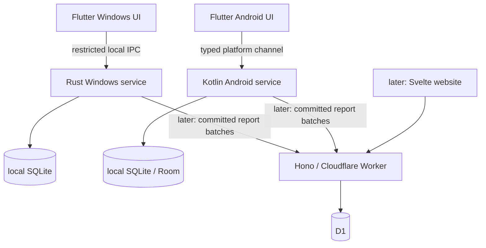

# Architecture

## One repository, independently built targets

Flutter, Kotlin, Rust, TypeScript and Svelte change together at the measurement
contract. A monorepo keeps that boundary, design tokens, CI and issue context
in one place. Each target keeps its normal tooling; do not add a cross-language
build framework. npm workspaces cover JavaScript only.

Traffic does not travel through NetScope's cloud. Local mode must remain useful
without account credentials, a cloud deployment, or a running Flutter engine.

## Native boundaries

Windows collection is an OS service, not a Dart timer or a tray application's
background loop. Use the least privileges justified by measured APIs. Restrict
IPC to the appropriate local user and a small typed command set; bind device
ownership explicitly on shared Windows machines.

Android collection uses supported OS APIs and an honest background lifecycle.
Kotlin owns sampling, coverage events, durable writes and short sync jobs.
Flutter owns screens and user actions. Use a typed channel (Pigeon if useful).
No VPN fallback, hidden API, root fallback, or dependency on keeping an Activity
alive. WorkManager is for deferrable work, not a promise of continuous sampling.

## Cloud boundary (later)

One Hono application with modules for auth, groups, devices, ingest, reports
and settlements; one D1 database initially. Use Drizzle only when implementing
the data layer. Better Auth must pass a Worker/D1/CPU-budget integration spike
before becoming part of the running service.

Device credentials authorize that device's reports only; human permissions
authorize reading group totals and managing periods. Web sessions use secure
HttpOnly cookies. Do not pass a user password to a native background service.
Use a reviewed short-lived pairing flow and OS-protected device credentials.

Keep domain rules separate from framework request handlers. Share schemas and
fixtures through `packages/contracts`, not a generic repository abstraction.
The server never trusts a caller-provided household ID without authorization.

## Source precedence

Only one accepted source covers an interval for a device/network. An OS history
re-query revises that interval; it is not extra consumption. A collector epoch
and monotonic revision distinguish resets from duplicates. Different devices
behind a tether/hotspot can double-count the same traversal; record this as an
unsupported/needs-review case until the collection path is established.

## Persistence and failure behavior

Persist first, upload later, acknowledge only committed rows. Replayed batches
are idempotent. Write counters and their checkpoint/epoch together locally.
Do not advance a cursor on a rejected upload. Reconcile late OS buckets instead
of manufacturing fine-grained data from coarse statistics.

Cloud unavailability means stale sync, not missing local measurement. Process
death/network transitions can mean missing measurement even when sync is fresh.
Use explicit timestamps, unknown coverage and explainable quality flags.

## Current versus planned

The foundation API implements health only. The client is a non-measuring shell.
There are intentionally no production auth stubs, D1 IDs, native collector
stubs, imaginary users, or successful upload endpoints. See STATE and issues.
